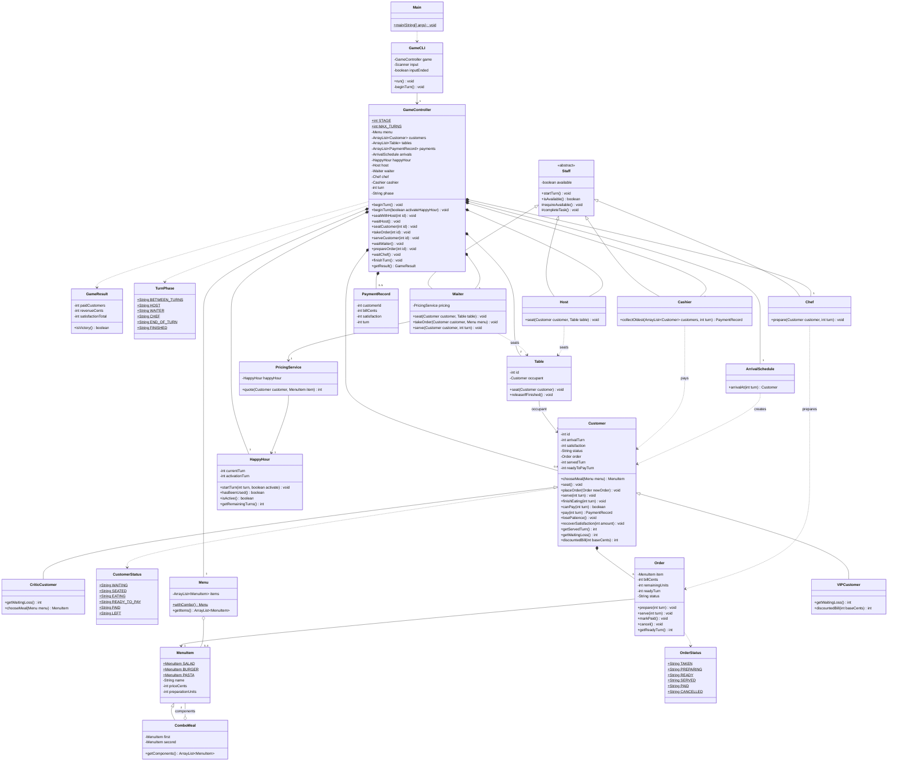

# Restaurant Rush design

This describes Stage 3. Private fields hold state; public methods
perform the permitted operations. The CLI reads choices and displays results.
The controller coordinates turns; domain objects keep their own rules.
`Main.main()` is the Java entry point. It creates the controller and console UI,
then calls `GameCLI.run()`, whose loop runs the game until turn 18 finishes.
The console reads cooking and service timestamps through getters to explain
earliest service and payment turns. Estimates state their cooking assumptions
and flag payments beyond closing. Displayed satisfaction uses integer arithmetic
to round to one decimal place; the victory calculation keeps the exact totals.

## Course concepts

| Topic | Application |
| --- | --- |
| Classes, objects and encapsulation (Chapter 2) | Customer, Order and Table expose operations instead of public mutable fields. |
| Object composition (Chapter 2) | A Customer has an Order; GameController owns the game-session customers, tables and staff. |
| Inheritance and abstract classes (Chapter 3) | Staff shares the task allowance; its subclasses provide their own tasks. |
| Exception handling (Chapter 4) | Invalid choices are explained and retried without consuming a staff task. |
| ArrayList and ordinary loops (Chapter 5) | Hold and traverse the small collections of game objects. |
| Polymorphism (Chapter 5) | Customer references call the appropriate VIP or Critic overrides. |
| Composition and inheritance | ComboMeal is a MenuItem containing two existing MenuItem components. |

## Class diagram

Fields and important operations match the Java source. State names are String
constants declared with static final, not enums. Shared menu components use aggregation.
The PDF report presents the same model in complementary control, customer, staff
and menu views so that signatures remain readable. The controller owns one of each
staff role, one menu, arrival schedule and Happy Hour state, two tables, up to six
customers and up to five payment records. A table and a customer each participate
in at most one current occupancy association; tables do not own customers.



## Sequence diagram

In this scenario C1 occupies the first table and the second table is free. The manager activates
Happy Hour on turn 4 and uses the Host to seat VIP C2,
leaving the Waiter free to take the order that turn. Using the Waiter only for
seating would delay the earliest order and payment by one turn.

```mermaid
sequenceDiagram
    actor Manager
    participant CLI as GameCLI
    participant G as GameController
    participant A as ArrivalSchedule
    participant H as HappyHour
    participant Host
    participant T as Table
    participant W as Waiter
    participant P as PricingService
    participant Chef
    participant Cash as Cashier
    Manager->>CLI: activate Happy Hour, seat C2, order C2
    CLI->>G: beginTurn(true) on turn 4
    G->>H: startTurn(4, true)
    G->>A: arrivalAt(4)
    create participant C as VIPCustomer C2
    A->>C: new VIPCustomer(2, 4)
    A-->>G: C2
    G->>C: recoverSatisfaction(15), capped at 100
    CLI->>G: seatWithHost(2)
    G->>Host: seat(C2, table)
    Host->>T: seat(C2)
    T->>C: seat()
    CLI->>G: takeOrder(2)
    G->>W: takeOrder(C2, menu)
    W->>C: chooseMeal(menu)
    C-->>W: Burger
    W->>P: quote(C2, Burger)
    P->>C: discountedBill(1500)
    C-->>P: 1350
    P->>H: isActive()
    H-->>P: true
    P-->>W: 1080 cents
    create participant O as Order
    W->>O: new Order(Burger, 1080)
    W->>C: placeOrder(order)
    CLI->>G: prepareOrder(2)
    G->>Chef: prepare(C2, 4)
    Chef->>O: prepare(4)
    Note right of O: READY, serving allowed next turn at earliest
    CLI->>G: finishTurn()
    G->>C: losePatience(), now 95
    Note over CLI,G: Turn 5
    CLI->>G: beginTurn(false)
    G->>H: startTurn(5, false)
    G->>C: recoverSatisfaction(15), now 100
    CLI->>G: waitHost(), serveCustomer(2)
    G->>W: serve(C2, 5)
    W->>C: serve(5)
    C->>O: serve(5), now SERVED
    CLI->>G: waitChef(), finishTurn()
    G->>C: finishEating(5), remains EATING
    Note over CLI,G: Turn 6, Happy Hour expires
    CLI->>G: beginTurn(false), role choices, finishTurn()
    G->>C: finishEating(6), now READY_TO_PAY
    G->>Cash: collectOldest(customers, 6)
    Cash->>C: canPay(6)
    C-->>Cash: false, became ready this turn
    Note over CLI,G: Turn 7, after role choices; C2 is oldest eligible payer
    CLI->>G: finishTurn()
    G->>Cash: collectOldest(customers, 7)
    Cash->>C: canPay(7)
    C-->>Cash: true, ready since turn 6
    Cash->>C: pay(7)
    C->>O: markPaid()
    C-->>Cash: PaymentRecord, 1080 cents and satisfaction 100
    Cash-->>G: payment record
    G->>T: releaseIfFinished()
    loop Remaining turns through 18
        Manager->>CLI: staff choices
        CLI->>G: beginTurn, role choices, finishTurn
    end
    CLI->>G: getResult()
    create participant Result as GameResult
    G->>Result: new GameResult(paid, revenue, satisfactionTotal)
    G-->>CLI: result
    CLI->>Result: isVictory()
    Result-->>CLI: threshold comparison
    alt paid >= 4 and revenue >= 4500 and satisfactionTotal >= 60 * paid
        CLI-->>Manager: FINAL: VICTORY
    else at least one threshold fails
        CLI-->>Manager: FINAL: DEFEAT
    end
```

## Design choices

Each class has a specific responsibility. Staff shares only the one-task
allowance, while the roles keep distinct operations. Customer and Order use
separate states because eating/payment eligibility differs from food readiness.
Private timestamps enforce the required delays. The waiting queue is derived
from waiting customers in arrival order, avoiding a second membership list.

An alternative was to put VIP and Critic behaviour in controller type checks.
Instead, calls through Customer references select the right overridden methods.
The same seating, serving and payment flow applies to every customer type.

The Host and Waiter reuse Table.seat. HappyHour stores timing; PricingService
calculates the bill only when ordering. ComboMeal keeps two existing menu objects.
This adds the new behaviour without changing the Chef or Cashier.

Ordinary loops are sufficient for six customers. Returned ArrayLists are copies
of the containers; they refer to the same domain objects. The CLI reads those
objects and requests changes through the controller. A larger system could need
additional boundaries, but this assignment does not require a framework.
